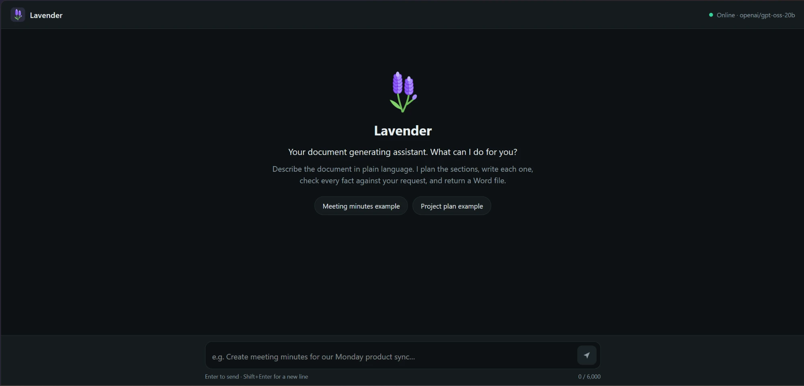
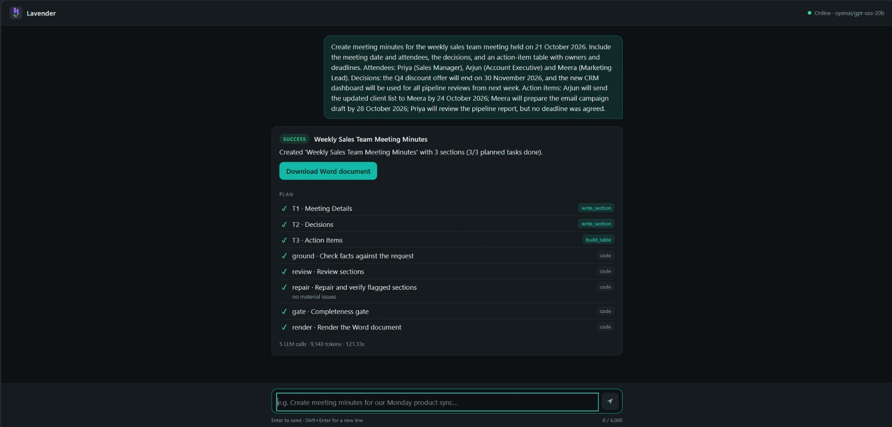

# Lavender AI: Autonomous Document Agent


An autonomous AI agent that turns a plain-language request ("Create meeting minutes for…", "Draft a proposal for…") into a finished,
fact-checked Word document.

<table>
  <tr>
    <td width="50%"></td>
    <td width="50%"></td>
  </tr>
  <tr>
    <td align="center"><em>Chat UI</em></td>
    <td align="center"><em>A finished request: plan, checks and Word download</em></td>
  </tr>
</table>

## Why I built it

LLMs write fluent documents, but they also invent owners, dates and decisions that nobody agreed on.
Lavender AI is my take on an agent you can trust with business documents: **the LLM proposes, code
decides.** Every fact is checked against the request, every suggestion is labelled as a proposal, and a
document that fails its own checks is never delivered.

**Highlights**
- Plan → write → ground → review → repair → render, with every LLM output validated by strict Pydantic schemas.
- Four layers of guardrails enforced in code: input screens, plan validation, fact grounding and a final gate.
- Token budgeting and a process-wide rate pacer built for a free-tier LLM API.
- 101 offline tests with a fake LLM, plus measured live runs with the exact inputs and outputs in `samples/`.

## How it works

Turns a plain-language request ("Create meeting minutes for…", "Draft a proposal for…") into a finished
Word document. The agent **plans** the sections, **writes** each one with an LLM, **checks** every fact
against the request, **reviews and repairs** its own output, and only then **renders** a `.docx`.

- **API:** FastAPI at `http://localhost:8000` (Swagger UI at `/docs`).
- **UI:** a small chat page at `http://localhost:8000`, named *Lavender*.
- **LLM:** one model, Groq `openai/gpt-oss-120b`, on the free tier. The Word file is built locally with
  python-docx; the LLM only ever returns JSON text.
- **Headline improvement:** request validation and guardrails (see [Guardrails](#guardrails-the-headline-improvement)).

Design decisions, rejected alternatives and design Q&A for every step are in [docs/DECISIONS.md](docs/DECISIONS.md).

---

## Setup

Requirements: Python 3.10+ and a free Groq API key from https://console.groq.com.

```bash
python -m venv .venv
.venv\Scripts\activate            # Windows
# source .venv/bin/activate       # macOS / Linux
pip install -r requirements.txt
copy .env.example .env            # Windows   (cp .env.example .env on macOS / Linux)
```

Open `.env` and set `GROQ_API_KEY=` to your key. Every other value has a working default. `.env` is
git-ignored; never commit it.

## Run

```bash
python -m uvicorn app.main:app --reload
```

- Chat UI: http://localhost:8000. Type a request or click an example chip.
- Swagger: http://localhost:8000/docs, then `POST /agent` with `{"request": "..."}`.
- Health: http://localhost:8000/health (no LLM call).

On the free tier a short document takes about 2 minutes and a 6-section one up to about 6 minutes,
mostly waiting for Groq's per-minute token limit (see [Budgets](#budgets-sized-for-the-groq-free-tier)).

## Run the tests (offline, no API key)

```bash
python -m pytest
```

---

## API

| Endpoint | Purpose |
|---|---|
| `POST /agent` | Body `{"request": "..."}`. Returns status, message, plan (every task and code step with ✓/✕/–), warnings, usage (calls, tokens, seconds, failed attempts) and `document_url` |
| `GET /documents/{name}` | Downloads a generated `.docx`. Only names the agent created are served; anything else is 404 |
| `GET /health` | Liveness check, model name and the request-length limit |

| HTTP | Status | Meaning |
|---|---|---|
| 200 | `success` | Every planned section delivered |
| 200 | `partial` | Document delivered, but an optional section was dropped or a requested item had no source facts; the reason is in `message` and `warnings` |
| 400 | `failed` | Refused by an input screen before any LLM call |
| 422 | `failed` | Not a document request (one LLM call), or an invalid body (empty, too long) |
| 502 | `failed` | No valid document could be produced; **no link is returned** |

---

## Architecture

```
request ─► screen ─► analyze ─► validate plan ─► execute tasks ─► ground ─► completeness
          (code)     (1 LLM)    (code, 1 re-plan   (1 LLM call     (code)     (code)
                                 + code merge)      per section)
        ─► review ─► repair + verify ─► final gate ─► render .docx + reopen-verify
           (LLM,      (LLM, ≤3 sections,  (code)        (code)
            chunked)   then code re-ground)
```

| File | Job |
|---|---|
| `app/main.py` | FastAPI app factory, routes, static UI |
| `app/config.py` | Typed settings from `.env`, checked at startup |
| `app/llm.py` | Groq transport, token estimator, process-wide token pacer, per-request budget ledger, JSON-schema retries, `FakeLLM` for tests |
| `app/schemas.py` | Pydantic models for every LLM output (`extra="forbid"`) and the API |
| `app/guardrails.py` | Input screens, plan validation, dependency order, plan merge/fold, required flags |
| `app/grounding.py` | Record-vs-proposal grounding, completeness re-check, final gate |
| `app/tools.py` | The two tools the planner may use (`write_section`, `build_table`) and the content rules |
| `app/agent/planner.py` | Analyze call, plan validation, one re-plan |
| `app/agent/executor.py` | Runs tasks in dependency order; a dependent section receives its prerequisites' validated content |
| `app/agent/review.py` | Chunked review, repair (max 3 sections), re-grounding and verification |
| `app/agent/pipeline.py` | The only place that decides success / partial / failed |
| `app/docx_builder.py` | Builds the Word file, saves atomically, reopens it to verify |
| `static/` | Chat UI (plain HTML/CSS/JS, no build step) |

**Who decides what:** the LLM proposes (the plan, section text, review findings). Code decides
(whether the plan is valid, which facts survive, whether the document may be delivered, and the final
status). Every LLM output is parsed into a strict Pydantic model; anything that doesn't fit is retried
with the validation error as feedback, at most twice.

---

## Guardrails (the headline improvement)

Four layers, each enforced in code:

1. **Input checks, before any LLM call (0 tokens):** a length limit, plus keyword screens for prompt
   injection ("ignore previous instructions…") and clearly unsafe requests. The request is passed to the
   model only inside `<request>` tags, as data.
2. **Plan validation, before any section is written:**
   - task count limits; known tools only;
   - unique IDs; dependencies that exist and don't form a cycle;
   - every requested item covered. The automatic Assumptions section counts as coverage only when
     assumptions exist.

   An invalid plan gets **one** re-plan with the exact errors. If the re-plan is still over the task
   limit, code merges neighbouring same-tool tasks that don't depend on each other, keeping every covered
   item. A planned "Assumptions" task is folded into the automatic section, so it is never duplicated.
   **Required** is set by code: a task is required if and only if it covers a requested item.
3. **Grounding, after writing:**
   - Every item is a **record** (a fact from the request) or a **proposal** (the agent's suggestion).
   - A record must quote the request. Each fact field (owner, due, value) is checked on its own; an
     unsupported one becomes **"To be confirmed"**, and an unsupported record is removed. In record
     documents such as minutes, decisions, actions, attendees and figures are always treated as records.
   - Unknown assumption IDs are stripped.
   - A completeness re-check marks a requested section with no source facts as "to be confirmed"
     (partial) and fails a required section with nothing supported.
   - After review, a record repeated in several sections (e.g. a decision under both "Meeting Details"
     and "Decisions") is kept only where items of its type make up the largest share. Ties keep both
     copies, proposals are never removed, and a section is never emptied this way.
4. **Final gate, before rendering:** every requested item is covered, **every proposal carries a visible
   label** (Proposed, Recommended, Potential or Illustrative; an assumption ID alone is not enough), and
   no required section contains placeholder text. Any failure means no document.

**Budget guardrails:**
- a per-request token ceiling and deadline;
- a per-call cap: an oversized call is never sent, and a provider "too large" error is never resent;
- a process-wide pacer that books tokens ahead so the per-minute limit isn't hit;
- `retry-after` honoured on 429, at most 3 waits.

**Self-check:** a review call looks for unsupported facts, missing requested items, unlabelled
proposals, contradictions between sections, content under the wrong heading and substantial duplication.
Material issues are repaired (at most 3 sections), re-grounded and re-reviewed. An unresolved issue
fails a required section, or drops an optional one (partial).

---

## Budgets (sized for the Groq free tier)

| Setting | Value | Why |
|---|---|---|
| `REQUEST_TOKEN_CEILING` | 40,000 | Hard maximum per request, not expected usage (measured runs: about 9–24K) |
| `REQUEST_DEADLINE_S` | 480 | The free tier allows about two section calls per minute |
| `PER_CALL_TOKEN_CAP` | 6,500 | Stays under Groq's 8K tokens per minute |
| `PACER_WINDOW_TOKENS` / `_S` | 7,500 / 60 | Margin under the 8K TPM limit |
| `MAX_PLAN_TASKS` | 6 | A 6-section plan plus review and a repair fits the deadline |
| `LLM_CALL_TIMEOUT_S` | 30 | Real calls take about 5–15 s |

The limits were set from an offline simulation of the real pacer after a live 8-section run failed at
the old 300 s deadline (see DECISIONS.md, "Fix: budget limits sized for the Groq free tier").

---

## Test results

### Offline code checks (pytest + FakeLLM)

**101 tests, all passing in about 1.3 s, no warnings, no API key.** FakeLLM replaces only the network
call, so the real retry, pacing, budget, planning, grounding, review, gate, rendering and API code all
runs. Tests use code defaults (`.env` is ignored), so results don't depend on the machine.

| Plan test group | Files |
|---|---|
| 1. Empty / too long / injection → 0 LLM calls; off-topic → 1 call, no document | `test_api.py`, `test_pipeline.py`, `test_guardrails.py` |
| 2. Invalid plan → one re-plan → failed; required set from covers | `test_guardrails.py`, `test_pipeline.py`, `test_plan_limits.py` |
| 3. Required task failed or skipped → 502, no link; optional → partial; prerequisites in prompt | `test_pipeline.py` |
| 4. Bad JSON retried and counted; truncation; 413 not resent | `test_llm.py` |
| 5. Pacer waits; deadline and ceiling stop calls; over-cap not sent | `test_llm.py` |
| 6. Grounding: "To be confirmed", removal, proposals, labels, unknown assumptions | `test_grounding.py` |
| 7. Completeness: note + partial, failure cases | `test_completeness.py` |
| 8. Review: chunking within cap, oversized section, repair + verify, unresolved, incomplete | `test_pipeline.py` |
| 9. Gate / render failure → no link; docx reopens correctly; unused table columns hidden; path traversal rejected | `test_pipeline.py`, `test_docx.py`, `test_api.py` |
| Duplicates: a record repeated across sections stays where its type belongs; ties and proposals kept | `test_duplicates.py` |

Regression tests replay each live failure found during development: the 8-section deadline skip, the
7-task re-plan, the required extra "Conclusion", and the duplicated Assumptions section.

**What these tests do not prove:** the model's writing quality (consistency, relevant assumption
references, sensible roles, length). That is prompt behaviour and can only be judged on live output,
below.

### Live demos (real Groq API, measured)

Exact requests, JSON responses and Word files are in [`samples/`](samples/). Each attempt has its own
folder; earlier attempts are kept, not overwritten.

#### In the UI: sales meeting minutes (`openai/gpt-oss-20b`)

Request: [`samples/03-sales-minutes-request.txt`](samples/03-sales-minutes-request.txt). Result:
**success**, 3/3 planned sections, 5 LLM calls, 9,143 tokens, 121.3 s. The plan list shows each
LLM-written section, then the code steps: fact grounding, review, repair (no material issues),
completeness gate and rendering.


#### Measured attempts (`openai/gpt-oss-120b`)

| Demo | Attempt | Status | LLM calls | Tokens | Duration | Outcome |
|---|---|---|---|---|---|---|
| 1. Meeting minutes | `attempt-1` | partial | 6 | 10,459 | 122.4 s | Summary dropped; Attendees and Decisions each repeated all 8 records → section-scope fixes |
| 1. Meeting minutes | **`attempt-2`** | **success** | 6 | **9,344** | **120.7 s** | **Accepted** |
| 2. Feedback-pilot proposal | `attempt-2` | failed (502) | 8 | 14,364 | 182.4 s | Planner added an unrequested "Conclusion", required by default, emptied by repair → required set from covers; section count respected |
| 2. Feedback-pilot proposal | `attempt-3` | success | 5 | 9,632 | 120.8 s | Roles left "To be confirmed"; Assumptions section duplicated → role and assumption-coverage fixes |
| 2. Feedback-pilot proposal | **`attempt-4`** | **success** | 5 | **10,590** | **123.7 s** | **Accepted, with notes below** |

#### Demo 1, accepted (`samples/attempt-2/01-meeting-minutes.*`)
- ✅ All supplied facts are correct: three attendees with roles; v2 launch on 15 November 2026;
  analytics redesign deferred to Q1 2027; Nikita by 5 November; Raghav by 28 October.
- ✅ **Abhinav's deadline is "To be confirmed"** (no deadline was agreed).
- ✅ Attendees, Summary, Decisions and Action Items each contain only their own content.
- ✅ No invented facts; correctly "No planning assumptions were needed".
- ⚠️ The summary is one generic sentence, with a slight inference ("to discuss upcoming releases and
  priorities"). Paragraphs aren't grounded by code, only structured items are.
- ⚠️ The action table shows an empty "Value" column because the model labelled it.

#### Demo 2, accepted (`samples/attempt-4/02-feedback-pilot-proposal.*`)
- ✅ **Decisions under missing information:** team size and tool unknown → labelled assumptions A1
  (a small cross-functional team) and A2 (an existing free or low-cost survey tool). Roles are job
  functions marked "(or equivalent)"; no named people.
- ✅ Practical approach; five-day plan (Day 1 design → Day 5 present) with **suggested roles**
  (Product lead, Marketing specialist, Customer success lead, Data analyst).
- ✅ Two risks (low response rate, data quality) labelled *Potential*, each with a *Recommended*
  mitigation tied to a day in the plan.
- ✅ Every proposal is labelled. There is **one** Assumptions section (the automatic one).
- ✅ **Three content sections, as requested.** The document has **four headings** because the automatic
  Assumptions section is always appended and isn't one of the planned sections.
- ⚠️ **One page: likely not met (estimate).** About 572 words in 29 paragraphs/bullets; Word wasn't
  available to count pages, and the agent has no length control.
- ⚠️ A stray line "Include a practical approach" (a requested-item description echoed by the model);
  each day has a second, redundant "role" bullet.
- ⚠️ A1 says a team "will be allocated", which leans towards implying available staff although it's
  a labelled assumption. Some assumption citations are loose (e.g. risks citing A1/A2).
- ⚠️ Minor timeline oddity: the reminder is sent on Day 3, the same day the survey launches.

**Earlier complex run (development):** a CRM cloud-migration plan with conflicting constraints
succeeded after the budget and merge fixes: 6 sections, 11 calls, 23,941 tokens, 364.4 s. It is not
part of `samples/`.

---

## Known limitations

- **No conversation memory and no RAG.** Each request stands alone (deliberately deferred to keep the
  token budget predictable).
- **Request length:** the API accepts 6,000 characters, but the planning call fits only about
  **2,453 characters** within the 6,500-token per-call cap (measured with the estimator). Longer
  requests fail clearly (502, "context too large") rather than being trimmed.
- **Speed on the free tier:** about two section calls per minute, so 2–6 minutes per document.
- **Daily quota on the free tier:** 200K tokens per day for `gpt-oss-120b`, about 8–20 documents (measured
  runs use about 9–24K tokens; failed runs count too). When it runs out, Groq answers 429 with long waits and
  the agent stops at the deadline with a clear reason. `GROQ_MODEL=openai/gpt-oss-20b` is a drop-in
  fallback with its own quota. The attempts table was measured on 120b; the UI screenshot run is on 20b.
- **Grounding is a substring check:** a true fact written differently (another date format) becomes
  "To be confirmed". Only structured items are grounded; free paragraphs rely on the prompt rules and the
  review.
- **Keyword input screens** catch obvious injection and unsafe requests only. They are not a classifier.
- **Merging over-long plans is by position**, not meaning; it never merges dependent tasks or mixes
  tools.
- **Prompt-dependent quality (checked live only):** consistency between sections, relevance of assumption
  citations, length targets such as "one page", and occasional echoed request lines (automatic removal
  was rejected because it could delete legitimate constraints).
- Single process: the pacer is per process; no authentication; generated files in `outputs/` are not
  cleaned up.
- The UI answers greetings from a fixed word list in the browser; everything else goes to the agent.

## Project layout

```
app/                FastAPI app, settings, LLM wrapper, guardrails, grounding, tools, agent/, docx builder
static/             Chat UI (Lavender)
tests/              101 offline tests (pytest + FakeLLM)
samples/            Demo requests, and per attempt the JSON response and Word file
docs/DECISIONS.md   Decisions, rejected alternatives, design Q&A
.env.example        Every setting, with comments
```

## Author

**Puneet Sharma** · [GitHub @dspuneetsharma](https://github.com/dspuneetsharma)
